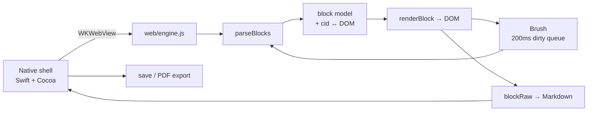
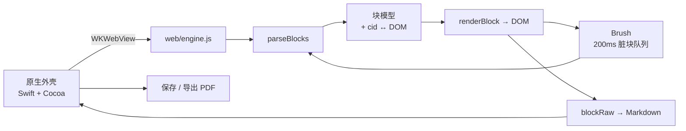

<div align="center">

# MarkFrame

**A Markdown editor for macOS built the way Typora is built — native Cocoa shell + WKWebView, no Electron.**
**按 Typora 的架构实现的 macOS Markdown 编辑器 —— 原生 Cocoa 外壳 + WKWebView，不是 Electron。**

[](#build)
[](Sources/)
[](test/)
[](LICENSE)

[English](#english) · [简体中文](#简体中文)

</div>

---

## English

### What is this

MarkFrame is a WYSIWYG Markdown editor for macOS. You type Markdown in a live-preview surface, and export to a print-quality A4 PDF.

It started as an experiment: I reverse-engineered Typora's architecture with REA (Reverse Engineer Anything), then rebuilt the same design from scratch to see whether the ideas actually hold up. They do — and the interesting parts are documented in the code.

It is **not** a Typora replacement and does not aim to be. It is a working, readable implementation of the same core ideas: about 5,000 lines of Swift + JavaScript with zero third-party runtime dependencies.

### Why it is not Electron

Typora on macOS is a native Cocoa shell that hosts a WKWebView. MarkFrame does the same:

| | Electron apps | MarkFrame |
|---|---|---|
| Binary size | ~150 MB | **~500 KB** |
| Runtime | Chromium + Node | System WebKit |
| Native bridge | IPC / preload | `WKScriptMessageHandler` + `prompt()` sync channel |

The whole editor is ~5,000 lines: 1,000 Swift, 2,900 web core, 500 features, 600 tests.

### Features

| Area | What works |
|---|---|
| **Editing** | Paragraphs, H1–H6, quotes, ordered/unordered lists, fenced code, tables, horizontal rules, YAML front matter |
| **Inline** | Bold, italic, inline code, strikethrough, links, images |
| **Live preview** | Lossless DOM: every inline element remembers its source markers, so Markdown is reconstructed from the DOM, not from a shadow buffer |
| **200 ms brush** | Only dirty blocks get re-rendered; identical HTML means zero DOM writes |
| **`expand`** | Move the caret into `**bold**` and the markers float back into view |
| **Source mode** | `Cmd+/` round-trips between rendered and raw text |
| **Tables** | Tab / Shift-Tab cell navigation, auto row on last cell, CJK-aware column widths |
| **Find & replace** | `Cmd+F`, uses the CSS Custom Highlight API — it never mutates the document |
| **Outline** | `Cmd+Shift+O`, heading tree with current-section tracking |
| **Focus / typewriter** | `Cmd+Shift+F` / `Cmd+Shift+T` |
| **Themes** | System / light / dark / sepia / Nord, `Cmd+Shift+L` |
| **Files** | Double-click `.md`, drag to window, Open Recent, CLI argument, autosave, close confirmation |
| **Export** | Paginated A4 PDF, self-contained HTML, code highlighting, pasted images saved to `assets/` |

### Architecture



The document model is the source of truth, but the DOM is the lossless copy:

```
parseBlocks ──► block tree ──► renderBlock
     ▲                │
     └── blockRaw ◄────┘        getMarkdown() = sourceMode ? textarea : blocks.map(blockRaw)
```

Each inline element carries `data-open` / `data-close` with its Markdown markers, so `blockRaw()` can turn `<strong>bold</strong>` back into `**bold**` without a second buffer.

### How the PDF export works

This is the part worth reading (`web/engine.js` §13.5 and `Sources/EditorWindow.swift`).

WebKit's own printing is unusable here — measured, not assumed:

| Approach | Result |
|---|---|
| `WKWebView.printOperation(with:)` | ~100,000 blank pages, 150 MB+ |
| `NSPrintOperation(view:)` | Correct page count, but every page is blank (WebKit renders out of process) |

So MarkFrame paginates by itself:

1. **Layout in JS.** Blocks are poured into A4 page boxes (794 × 1123 px → 595 × 842 pt). Blocks taller than a page (tables, code, lists, quotes) are split at row / line / item boundaries; a continuation chunk is never placed on the same page as its predecessor.
2. **Capture per page.** Native renders one page at a time in a dedicated off-screen `WKWebView` and calls `createPDF` with an exact page rect.
3. **Merge.** PDFKit scales each captured page into A4 and writes the final file.

Typography is matched to Typora's own output: body 9.1 pt, 13 mm side margins, no heading underlines, no repeated table headers on continuation pages, front matter hidden.

Four things that silently broke and are now pinned by tests:

- `document.styleSheets[].cssRules` throws `SecurityError` for `file://` in WKWebView → export HTML had almost no CSS. Fixed by injecting `style.css` from the app bundle.
- Code blocks wrapped in the export page but were measured unwrapped → the last two lines got clipped.
- `PDFPage` holds its `PDFDocument` weakly → merged pages occasionally came out blank.
- A snapshot-and-slice approach (the first implementation) cannot avoid overlap at page boundaries. It was removed entirely.

### Build

Requirements: macOS 13+, Swift 6 toolchain (`xcode-select --install`). No npm, no Xcode project, no dependencies.

```bash
git clone https://github.com/Linley116/markframe.git
cd markframe
./build.sh          # compile + install to ~/Applications
```

`build.sh` compiles three Swift files with `swiftc`, assembles the `.app` bundle, ad-hoc signs it, and installs a single visible copy to `~/Applications` (so Launchpad does not show duplicates).

To keep the build artifact for distribution:

```bash
./build.sh --keep   # leaves build/MarkFrame.app in place
```

> The bundled `web/vendor/highlight.min.js` (highlight.js 11.9.0, BSD-3-Clause) is vendored on purpose so the build works offline.

### Keyboard shortcuts

| Action | Shortcut |
|---|---|
| New / Open / Save / Save As | `Cmd+N` / `Cmd+O` / `Cmd+S` / `Shift+Cmd+S` |
| Export PDF / HTML | File → Export |
| Bold / Italic / Inline code | `Cmd+B` / `Cmd+I` / `Cmd+K` |
| Toggle source mode | `Cmd+/` |
| Find and replace | `Cmd+F` |
| Outline | `Shift+Cmd+O` |
| Focus mode / Typewriter | `Shift+Cmd+F` / `Shift+Cmd+T` |
| Next theme | `Shift+Cmd+L` |
| Zoom in / out / reset | `Cmd++` / `Cmd+-` / `Cmd+0` |

### Tests

```bash
NODE_PATH=./node_modules node test/engine.test.js      # 31 assertions — core loop
NODE_PATH=./node_modules node test/features.test.js    # 40 assertions — features
node test/bench.js                                     # performance baseline
./test/pdf-regression.sh                               # PDF structure + content
```

The JS suites drive real DOM in headless Chrome (`playwright-core` is the only dev dependency; point `NODE_PATH` at any install). The PDF regression exports a document containing a 60-row table, an 80-line code block and an end marker, then checks: multiple pages, no blank page, uniform A4 size, fill ratio, and that the marker survived.

### Known limitations

- Inline markers are rendered with CSS pseudo-elements: **visible but not directly editable**. Use the shortcuts to toggle formatting.
- The parser is flat: no nested blocks (a list item cannot contain a quote or a code block).
- Table cells cannot contain a real line break.
- Undo is browser-native in live mode and textarea-native in source mode; they are not unified.
- Images work only for pasted content in a saved document (they go to `assets/` next to it); relative images may not resolve inside the PDF export.
- Super-tall paragraphs are split by character; inline formatting is lost for that paragraph only.
- The app is ad-hoc signed. Do not distribute the built `.app` without notarizing it.

### Roadmap

See [ROADMAP.md](ROADMAP.md) — completed work is struck through, so what is left is what is not crossed out. Short version: multi-document, editable inline markers, footnotes/TOC, math + Mermaid, unified undo stack, nested blocks.

### License

MIT — see [LICENSE](LICENSE). Highlight.js is BSD-3-Clause, © Josh Goebel and contributors.

---

## 简体中文

### 这是什么

MarkFrame 是一个 macOS 上的所见即所得 Markdown 编辑器：在实时预览的正文里写 Markdown，导出排版好的 A4 PDF。

它起初是个实验：我先用 REA（Reverse Engineer Anything）逆向了 Typora 的架构，再照着同样的设计从零实现了一遍，看看这些设计是否真的立得住。结论是立得住，关键实现都写在代码和注释里。

它**不是** Typora 的替代品，也没打算做成替代品。它是一份能跑、能读的同构实现：约 5,000 行 Swift + JavaScript，运行时零第三方依赖。

### 为什么它不是 Electron

Typora 在 macOS 上是「原生 Cocoa 外壳 + WKWebView」，MarkFrame 也是：

| | Electron 应用 | MarkFrame |
|---|---|---|
| 包体 | 约 150 MB | **约 500 KB** |
| 运行时 | Chromium + Node | 系统 WebKit |
| 原生桥 | IPC / preload | `WKScriptMessageHandler` + `prompt()` 同步通道 |

整个编辑器约 5,000 行：Swift 1,000 行、Web 内核 2,900 行、功能模块 500 行、测试 600 行。

### 功能

| 分类 | 能力 |
|---|---|
| **块级** | 段落、H1–H6、引用、有序/无序列表、围栏代码、表格、分隔线、YAML front matter |
| **行内** | 粗体、斜体、行内代码、删除线、链接、图片 |
| **实时预览** | 无损 DOM：每个行内元素都记着自己的源码标记，Markdown 从 DOM 反推，不靠影子缓冲区 |
| **200ms 画笔** | 只重绘脏块；块内 HTML 相同就完全不碰 DOM |
| **`expand`** | 光标移进 `**粗体**`，标记自动浮出来 |
| **源码模式** | `Cmd+/` 在渲染视图和原文之间双向切换 |
| **表格** | Tab / Shift-Tab 单元格导航、末格自动加行、按 CJK 宽度算列宽 |
| **查找替换** | `Cmd+F`，用 CSS Custom Highlight —— 不往文档里插任何标记元素 |
| **大纲** | `Cmd+Shift+O`，标题树 + 当前节高亮 |
| **专注 / 打字机** | `Cmd+Shift+F` / `Cmd+Shift+T` |
| **主题** | 跟随系统 / 明亮 / 深色 / 护眼 / Nord，`Cmd+Shift+L` |
| **文件** | 双击 `.md`、拖拽打开、最近打开、命令行参数、自动保存、关窗确认 |
| **导出** | 分页 A4 PDF、自包含 HTML、代码高亮、粘贴图片落到 `assets/` |

### 架构



文档模型是权威，但 DOM 是无损副本：

```
parseBlocks ──► 块树 ──► renderBlock
     ▲            │
     └── blockRaw ◄┘        getMarkdown() = 源码模式 ? textarea : blocks.map(blockRaw)
```

每个行内元素都带 `data-open` / `data-close`，存着自己的 Markdown 标记，所以 `blockRaw()` 能把 `<strong>粗体</strong>` 还原成 `**粗体**`，不需要第二份缓冲区。

### PDF 导出是怎么做的

这是最值得看的一部分（`web/engine.js` §13.5 与 `Sources/EditorWindow.swift`）。

WebKit 自带的打印在这里不可用 —— 这是实测结论，不是猜测：

| 方案 | 结果 |
|---|---|
| `WKWebView.printOperation(with:)` | 十万级空白页，150 MB+ |
| `NSPrintOperation(view:)` | 页数正常，但每页全白（WebKit 内容在独立进程里渲染） |

所以 MarkFrame 自己做分页：

1. **JS 排版**：把块装进 A4 页框（794 × 1123 px → 595 × 842 pt）。高过一页的块（表格、代码、列表、引用）按行 / 按项拆段，同一块的续段绝不和它的前一段落在同一页。
2. **逐页捕获**：原生在独立离屏 `WKWebView` 里一页一页 `createPDF`，每次只截一个精确的页面矩形。
3. **合并**：PDFKit 把每页缩放进 A4，写出最终文件。

排版参数对齐 Typora 的导出结果：正文 9.1pt、左右边距 13mm、标题无下划线、表格续页不重复表头、不渲染 front matter。

四个静默踩过的坑，现在都有测试兜着：

- WKWebView 里 `file://` 样式表的 `cssRules` 会抛 `SecurityError` → 导出 HTML 几乎没有样式。改为从 app bundle 注入 `style.css`。
- 代码块在导出页折行、测量时却不折行 → 页尾两行被裁掉。
- `PDFPage` 对 `PDFDocument` 是弱引用 → 合并时偶尔出现空页。
- 最初的「整页快照 + 坐标切片」方案在页边界必然重叠，已整体删除。

### 构建

要求：macOS 13+、Swift 6 工具链（`xcode-select --install`）。不需要 npm、不需要 Xcode 工程、没有第三方依赖。

```bash
git clone https://github.com/Linley116/markframe.git
cd markframe
./build.sh          # 编译 + 安装到 ~/Applications
```

`build.sh` 用 `swiftc` 编译三个 Swift 文件、组装 `.app`、ad-hoc 签名，并只往 `~/Applications` 装一份（避免启动台出现重复图标）。

要保留分发用的产物：

```bash
./build.sh --keep   # 保留 build/MarkFrame.app
```

> `web/vendor/highlight.min.js`（highlight.js 11.9.0，BSD-3-Clause）是刻意内置的，保证没网也能构建。

### 快捷键

| 操作 | 快捷键 |
|---|---|
| 新建 / 打开 / 保存 / 另存为 | `Cmd+N` / `Cmd+O` / `Cmd+S` / `Shift+Cmd+S` |
| 导出 PDF / HTML | File → Export |
| 粗体 / 斜体 / 行内代码 | `Cmd+B` / `Cmd+I` / `Cmd+K` |
| 切换源码模式 | `Cmd+/` |
| 查找替换 | `Cmd+F` |
| 大纲 | `Shift+Cmd+O` |
| 专注模式 / 打字机 | `Shift+Cmd+F` / `Shift+Cmd+T` |
| 下一个主题 | `Shift+Cmd+L` |
| 放大 / 缩小 / 实际大小 | `Cmd++` / `Cmd+-` / `Cmd+0` |

### 测试

```bash
NODE_PATH=./node_modules node test/engine.test.js      # 31 项 —— 核心闭环
NODE_PATH=./node_modules node test/features.test.js    # 40 项 —— 功能
node test/bench.js                                     # 性能基准
./test/pdf-regression.sh                               # PDF 结构 + 内容
```

JS 套件用无头 Chrome 驱动真实 DOM（`playwright-core` 是唯一的开发依赖，`NODE_PATH` 指向任意一份安装即可）。PDF 回归会导出一份包含 60 行表格、80 行代码块和结尾标记的文档，然后检查：多页、无空白页、A4 尺寸一致、填充率、结尾标记是否还在。

### 已知限制

- 行内标记用 CSS 伪元素显示：**看得见但不能直接编辑**，请用快捷键切换格式。
- 解析器是扁平的：没有嵌套块（列表项里放不了引用或代码块）。
- 表格单元格里不能有真正的换行。
- 撤销在实时模式下走浏览器、源码模式下走 textarea，两边没有统一。
- 图片只支持「已保存文档里的粘贴」（落到同级 `assets/`）；相对路径图片在 PDF 导出里可能缺失。
- 超高段落按字符切分，该段的行内格式会丢失（只影响那一段）。
- app 是 ad-hoc 签名，未公证前不要分发构建产物。

### 路线图

见 [ROADMAP.md](ROADMAP.md) —— 已完成项用删除线划掉，没划掉的就是待办。简版：多文档、行内标记可编辑、脚注/TOC、数学与 Mermaid、统一撤销栈、嵌套块。

### 许可证

MIT，见 [LICENSE](LICENSE)。Highlight.js 为 BSD-3-Clause，版权归 Josh Goebel 及贡献者所有。
