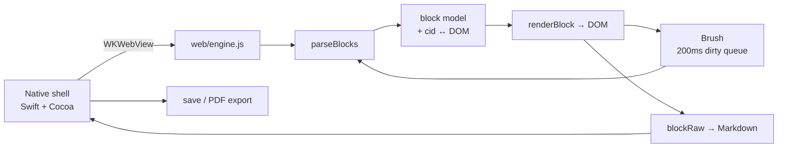

<div align="center">

# Markvis

**A Markdown editor for macOS built the way Typora is built — native Cocoa shell + WKWebView, no Electron.**

[](#build)
[](Sources/)
[](test/)
[](LICENSE)

English · [简体中文](README.zh-CN.md)

</div>

---

### What is this

Markvis is a WYSIWYG Markdown editor for macOS. You type Markdown in a live-preview surface, and export to a print-quality A4 PDF.

It started as an experiment: I reverse-engineered Typora's architecture with REA (Reverse Engineer Anything), then rebuilt the same design from scratch to see whether the ideas actually hold up. They do — and the interesting parts are documented in the code.

It is **not** a Typora replacement and does not aim to be. It is a working, readable implementation of the same core ideas, with zero third-party runtime dependencies.

**Install: build from source (see [Build](#build-install-from-source)). No prebuilt or notarized binaries are provided.**

### Why it is not Electron

Typora on macOS is a native Cocoa shell that hosts a WKWebView. Markvis does the same:

| | Electron apps | Markvis |
|---|---|---|
| Binary size | ~150 MB | **~3.9 MB** (about 2.5 MB of it is Mermaid) |
| Runtime | Chromium + Node | System WebKit |
| Native bridge | IPC / preload | `WKScriptMessageHandler` + `prompt()` sync channel |

The project is currently about 13,745 lines: 2,555 Swift, 5,945 web core, 2,549 features, and 2,696 tests.

### Features

| Area | What works |
|---|---|
| **Editing** | Paragraphs, H1–H6, quotes, ordered/unordered lists, fenced code, tables, horizontal rules, YAML front matter, GFM soft/hard line breaks |
| **Inline** | Bold, italic, inline code, strikethrough, inline and reference links, images, bracket/quote auto-pairing |
| **Live preview** | Lossless DOM: inline elements hold their source markers as real, hidden text nodes — Markdown is reconstructed from the DOM, not a shadow buffer |
| **200 ms brush** | Only dirty blocks get re-rendered; identical HTML means zero DOM writes |
| **`expand`** | Move the caret into `**bold**`, the markers float back into view — and they are editable: delete one `*`, arrow through them, type between them |
| **Source mode** | `Cmd+/` round-trips between rendered and raw text |
| **Code blocks** | Fenced highlighting for 180+ languages, a language dropdown in live mode, and language-name completion in source mode |
| **Multi-document** | One document per window, native macOS tab groups (`Cmd+T`), session restoration, and focusing an existing window instead of reopening the same file |
| **Tables** | Tab / Shift-Tab cell navigation, auto row on last cell, Enter for a cell line break (`<br>`), CJK-friendly column widths |
| **Find & replace** | `Cmd+F`, uses the CSS Custom Highlight API — it never mutates the document |
| **Outline / file sidebar** | `Cmd+Shift+O` toggles the unified left sidebar; `Cmd+Shift+E` opens its Files tab; outline headings collapse by level; width is remembered |
| **File tree** | Lazy loading, current-file highlighting, automatic external-change refresh, create/rename/duplicate/delete, sorting, in-tree drag, recent folders, and parent-directory navigation; deletes are undoable and name collisions on move are auto-renamed |
| **Quick Open** | `Cmd+Shift+P` fuzzy-searches documents under the current folder and opens the keyboard-selected result |
| **Input completion** | Type `:smi` in live mode to complete emoji; complete fenced-code language names in source mode, with aliases such as `py` / `js` / `ts`; ↑↓/Enter/Tab/Esc, undoable insertion |
| **Focus / typewriter** | `Cmd+Shift+F` / `Cmd+Shift+T` |
| **Themes** | System / light / dark / sepia / Nord plus your own CSS files, switched from the status-bar theme menu (`Cmd+Shift+L` cycles) |
| **Math / diagrams** | `$x$` and `$$…$$` via KaTeX, ```` ```mermaid ```` rendered to SVG — both lazy-loaded, and a click opens the source in a floating editor |
| **HTML blocks** | Block-level HTML previews in a sandboxed iframe (scripts disabled); the `</>` button opens a source overlay; PDF / HTML export flattens it to plain DOM |
| **Footnotes / TOC** | `[^id]` references with click-through to `[^id]: ...` definitions, `[TOC]` rebuilt from the current headings |
| **Spelling** | System spellcheck while typing (`Cmd+;` to toggle) |
| **Files** | Double-click `.md`, drag to window, Open Recent, CLI argument, autosave, close confirmation, crash recovery for untitled documents |
| **Export** | Paginated A4 PDF, self-contained HTML (images and KaTeX fonts inlined as data URLs), code highlighting, pasted images saved to `assets/` |

### Architecture



The document model is the source of truth, but the DOM is the lossless copy:

```
parseBlocks ──► block tree ──► renderBlock
     ▲                │
     └── blockRaw ◄────┘        getMarkdown() = sourceMode ? textarea : blocks.map(blockRaw)
```

Each inline element carries `data-open` / `data-close` with its Markdown markers, so `blockRaw()` can turn `<strong>bold</strong>` back into `**bold**` without a second buffer.

### How the PDF export works

This is the part worth reading (`web/engine.js` §13.5 and `Sources/EditorWindow.swift`).

WebKit's own printing is unusable here — measured, not assumed:

| Approach | Result |
|---|---|
| `WKWebView.printOperation(with:)` | ~100,000 blank pages, 150 MB+ |
| `NSPrintOperation(view:)` | Correct page count, but every page is blank (WebKit renders out of process) |

So Markvis paginates by itself:

1. **Layout in JS.** Blocks are poured into A4 page boxes (794 × 1123 px → 595 × 842 pt). Tall blocks split at row / line / item boundaries: tables by row, code by line, lists by item, quotes and HTML containers by child block. Ordinary paragraphs split by visible character with DOM Range, preserving bold, links, inline code, images and `<br>` across pages; a continuation chunk is never placed on the same page as its predecessor.
2. **Capture per page.** Native renders one page at a time in a dedicated off-screen `WKWebView` and calls `createPDF` with an exact page rect.
3. **Merge.** PDFKit scales each captured page into A4 and writes the final file.

Typography is matched to Typora's own output: body 9.1 pt, 13 mm side margins, no heading underlines, no repeated table headers on continuation pages, front matter hidden.

Four things that silently broke and are now pinned by tests:

- `document.styleSheets[].cssRules` throws `SecurityError` for `file://` in WKWebView → export HTML had almost no CSS. Fixed by injecting `style.css` from the app bundle.
- Code blocks wrapped in the export page but were measured unwrapped → the last two lines got clipped.
- `PDFPage` holds its `PDFDocument` weakly → merged pages occasionally came out blank. Captured pages are now stored as their `PDFDocument` so the page never outlives its owner.
- A snapshot-and-slice approach (the first implementation) cannot avoid overlap at page boundaries. It was removed entirely.

### Custom themes

Themes are plain CSS. Drop a file into `~/Library/Application Support/Markvis/themes/` and it appears in the theme menu at the bottom-right (the folder is created on first launch with a commented `example.css`; View → Open Theme Folder… jumps there).

```css
/* @name: Paper */
/* @base: light */

:root {
  --bg: #fbf8f3;
  --fg: #2f2a23;
  --accent: #8a5a2b;
  --mf-editor-width: 900px;
}
```

- `@name` is the label in the menu; without it the file name is used
- `@base` picks the palette to start from — `auto`, `light`, `dark`, `sepia` or `nord`. A dark theme should say `dark`, otherwise the parts it does not override stay light
- Everything is a CSS variable: `--bg`, `--fg`, `--muted`, `--accent`, `--mark`, `--code-bg`, `--border`, `--quote`, the `--hl-*` syntax colours, and `--mf-editor-width` for the reading column
- Only single-line directives count (`/* @name: x */` or a bare `@name: x` line), so prose inside a longer comment block is not misread as metadata
- The last CSS that was loaded is cached in `localStorage`, so the theme paints before the file is read; **Reload Custom Themes** re-reads it after an edit

> The theme menu itself is labelled in Chinese (主题 / 自定义 / 打开主题文件夹…), like the rest of the editor chrome.

### Build (install from source)

**The repository ships source only — there are no notarized binaries.** Apple notarization requires a paid Developer ID account, and an individual certificate publishes your legal name and Team ID inside the signature. Building from source is therefore the only official distribution method.

Requirements: macOS 13+, Swift 6 toolchain (`xcode-select --install`). The build itself needs no npm, no Xcode project, and no runtime dependencies; `playwright-core` is only used by the JS tests.

```bash
git clone https://github.com/Linley116/Markvis.git markvis
cd markvis
./build.sh          # compile + install to ~/Applications
```

`build.sh` compiles six Swift files with `swiftc`, assembles the `.app` bundle, ad-hoc signs it, and installs a single visible copy to `~/Applications` (so Launchpad does not show duplicates). Because you built it locally, it runs without Apple notarization.

Build without installing:

```bash
./build.sh --keep                    # leaves build/Markvis.app in place
MARKVIS_NO_INSTALL=1 ./build.sh --keep   # build only, leave ~/Applications alone
```

`release.sh` is a maintainer-only convenience for local DMG packaging. Its output is ad-hoc signed and not notarized — **do not publish it as a download**, because Gatekeeper will block it on other Macs.

> The bundled `web/vendor/highlight.min.js` (highlight.js 11.9.0, BSD-3-Clause) is vendored on purpose so the build works offline.

### Keyboard shortcuts

| Action | Shortcut |
|---|---|
| New / New tab / Open / Save | `Cmd+N` / `Cmd+T` / `Cmd+O` / `Cmd+S` |
| Toggle spellcheck | `Cmd+;` |
| Hard line break | `Shift+Enter` (or two trailing spaces / `\`, per GFM) |
| Line break inside a table cell | `Enter` / `Shift+Enter` (writes `<br>` without breaking the table) |
| Export PDF / HTML | File → Export |
| Bold / Italic / Inline code | `Cmd+B` / `Cmd+I` / `Cmd+K` |
| Toggle source mode | `Cmd+/` |
| Find and replace | `Cmd+F` |
| Toggle sidebar | `Shift+Cmd+O` |
| Show file tree | `Shift+Cmd+E` |
| Quick Open | `Shift+Cmd+P` |
| Focus mode / Typewriter | `Shift+Cmd+F` / `Shift+Cmd+T` |
| Next theme | `Shift+Cmd+L` |
| Zoom in / out / reset | `Cmd++` / `Cmd+-` / `Cmd+0` |

### Tests

```bash
node test/engine.test.js      # 136 assertions — core loop
node test/features.test.js    # 131 assertions — features
./test/native.sh                                       # native Swift tests
node test/bench.js                                     # performance baseline
./test/pdf-regression.sh                               # PDF structure + content
```

The JS suites drive real DOM in headless Chrome (`playwright-core` is the only dev dependency; run `npm ci` then `playwright-core install chromium`, or point `MARKVIS_TEST_CHROME` at a browser). The native suite covers path safety, session restore, file operations and undo, tree sorting, and the Quick Open index; it runs under XCTest when Xcode is available and falls back to a lightweight runner using the same scenarios with Command Line Tools only. The PDF regression exports a document containing a 60-row table, an 80-line code block and an end marker, then checks: multiple pages, no blank page, uniform A4 size, fill ratio, and that the marker survived.

### Known limitations

- Nested blocks work (lists in lists, code blocks and quotes inside items, multi-paragraph quotes). Tables still cannot be nested. Block-level HTML renders in a sandboxed iframe with scripts disabled; edit it through the `</>` source overlay.
- Table-cell line breaks are written as `<br>`; Markdown tables still cannot hold multiple paragraphs in one cell.
- Undo is snapshot-based (whole document + caret per step), which is why it survives mode switches and block re-parsing. The trade-off: a step restores the entire document rather than one node, so it is not cheap on very large files.
- Images work only for pasted content in a saved document (they go to `assets/` next to it). Relative paths resolve in the editor and are inlined as data URLs on export.
- Scripts inside block-level HTML never run. PDF export splits HTML by top-level block elements, but a single unbreakable element taller than one page may still be clipped.
- Custom themes are CSS only (no scripts), and PDF export always uses the light print palette — a dark theme does not turn the PDF black.
- Source only: there are no prebuilt or notarized binaries. Any DMG produced by `release.sh` is for local or internal use by the maintainer.

### Roadmap

See [ROADMAP.md](ROADMAP.md) — iterations are listed as a table with a check column, followed by the versioned fix log, deferred items, and the engineering notes behind the tricky parts. Distribution is source-only with no Apple notarization; incremental save is deferred and no longer scheduled.

### License

MIT — see [LICENSE](LICENSE) (third-party notices included).
