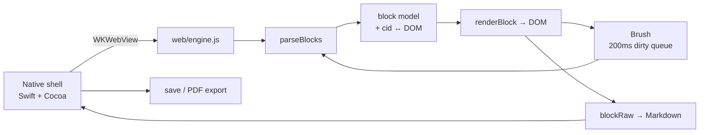

<div align="center">

# MarkFrame

**A Markdown editor for macOS built the way Typora is built — native Cocoa shell + WKWebView, no Electron.**

[](#build)
[](Sources/)
[](test/)
[](LICENSE)

English · [简体中文](README.zh-CN.md)

</div>

---

### What is this

MarkFrame is a WYSIWYG Markdown editor for macOS. You type Markdown in a live-preview surface, and export to a print-quality A4 PDF.

It started as an experiment: I reverse-engineered Typora's architecture with REA (Reverse Engineer Anything), then rebuilt the same design from scratch to see whether the ideas actually hold up. They do — and the interesting parts are documented in the code.

It is **not** a Typora replacement and does not aim to be. It is a working, readable implementation of the same core ideas: about 5,600 lines of Swift + JavaScript with zero third-party runtime dependencies.

### Why it is not Electron

Typora on macOS is a native Cocoa shell that hosts a WKWebView. MarkFrame does the same:

| | Electron apps | MarkFrame |
|---|---|---|
| Binary size | ~150 MB | **~500 KB** |
| Runtime | Chromium + Node | System WebKit |
| Native bridge | IPC / preload | `WKScriptMessageHandler` + `prompt()` sync channel |

The whole editor is ~5,600 lines: 1,200 Swift, 3,000 web core, 500 features, 800 tests.

### Features

| Area | What works |
|---|---|
| **Editing** | Paragraphs, H1–H6, quotes, ordered/unordered lists, fenced code, tables, horizontal rules, YAML front matter, GFM soft/hard line breaks |
| **Inline** | Bold, italic, inline code, strikethrough, links, images, bracket/quote auto-pairing |
| **Live preview** | Lossless DOM: every inline element remembers its source markers, so Markdown is reconstructed from the DOM, not from a shadow buffer |
| **200 ms brush** | Only dirty blocks get re-rendered; identical HTML means zero DOM writes |
| **`expand`** | Move the caret into `**bold**` and the markers float back into view |
| **Source mode** | `Cmd+/` round-trips between rendered and raw text |
| **Multi-document** | One document per window, native macOS tab groups (`Cmd+T`), opening a file never clobbers the current one |
| **Tables** | Tab / Shift-Tab cell navigation, auto row on last cell, CJK-aware column widths |
| **Find & replace** | `Cmd+F`, uses the CSS Custom Highlight API — it never mutates the document |
| **Outline** | `Cmd+Shift+O`, heading tree with current-section tracking |
| **Focus / typewriter** | `Cmd+Shift+F` / `Cmd+Shift+T` |
| **Themes** | System / light / dark / sepia / Nord, `Cmd+Shift+L` |
| **Files** | Double-click `.md`, drag to window, Open Recent, CLI argument, autosave, close confirmation |
| **Export** | Paginated A4 PDF, self-contained HTML (local images inlined as data URLs), code highlighting, pasted images saved to `assets/` |

### Architecture



The document model is the source of truth, but the DOM is the lossless copy:

```
parseBlocks ──► block tree ──► renderBlock
     ▲                │
     └── blockRaw ◄────┘        getMarkdown() = sourceMode ? textarea : blocks.map(blockRaw)
```

Each inline element carries `data-open` / `data-close` with its Markdown markers, so `blockRaw()` can turn `<strong>bold</strong>` back into `**bold**` without a second buffer.

### How the PDF export works

This is the part worth reading (`web/engine.js` §13.5 and `Sources/EditorWindow.swift`).

WebKit's own printing is unusable here — measured, not assumed:

| Approach | Result |
|---|---|
| `WKWebView.printOperation(with:)` | ~100,000 blank pages, 150 MB+ |
| `NSPrintOperation(view:)` | Correct page count, but every page is blank (WebKit renders out of process) |

So MarkFrame paginates by itself:

1. **Layout in JS.** Blocks are poured into A4 page boxes (794 × 1123 px → 595 × 842 pt). Blocks taller than a page (tables, code, lists, quotes) are split at row / line / item boundaries; a continuation chunk is never placed on the same page as its predecessor.
2. **Capture per page.** Native renders one page at a time in a dedicated off-screen `WKWebView` and calls `createPDF` with an exact page rect.
3. **Merge.** PDFKit scales each captured page into A4 and writes the final file.

Typography is matched to Typora's own output: body 9.1 pt, 13 mm side margins, no heading underlines, no repeated table headers on continuation pages, front matter hidden.

Four things that silently broke and are now pinned by tests:

- `document.styleSheets[].cssRules` throws `SecurityError` for `file://` in WKWebView → export HTML had almost no CSS. Fixed by injecting `style.css` from the app bundle.
- Code blocks wrapped in the export page but were measured unwrapped → the last two lines got clipped.
- `PDFPage` holds its `PDFDocument` weakly → merged pages occasionally came out blank.
- A snapshot-and-slice approach (the first implementation) cannot avoid overlap at page boundaries. It was removed entirely.

### Build

Requirements: macOS 13+, Swift 6 toolchain (`xcode-select --install`). No npm, no Xcode project, no dependencies.

```bash
git clone https://github.com/Linley116/markframe.git
cd markframe
./build.sh          # compile + install to ~/Applications
```

`build.sh` compiles three Swift files with `swiftc`, assembles the `.app` bundle, ad-hoc signs it, and installs a single visible copy to `~/Applications` (so Launchpad does not show duplicates).

To keep the build artifact for distribution:

```bash
./build.sh --keep   # leaves build/MarkFrame.app in place
```

> The bundled `web/vendor/highlight.min.js` (highlight.js 11.9.0, BSD-3-Clause) is vendored on purpose so the build works offline.

### Keyboard shortcuts

| Action | Shortcut |
|---|---|
| New / New tab / Open / Save | `Cmd+N` / `Cmd+T` / `Cmd+O` / `Cmd+S` |
| Hard line break | `Shift+Enter` (or two trailing spaces / `\`, per GFM) |
| Export PDF / HTML | File → Export |
| Bold / Italic / Inline code | `Cmd+B` / `Cmd+I` / `Cmd+K` |
| Toggle source mode | `Cmd+/` |
| Find and replace | `Cmd+F` |
| Outline | `Shift+Cmd+O` |
| Focus mode / Typewriter | `Shift+Cmd+F` / `Shift+Cmd+T` |
| Next theme | `Shift+Cmd+L` |
| Zoom in / out / reset | `Cmd++` / `Cmd+-` / `Cmd+0` |

### Tests

```bash
NODE_PATH=./node_modules node test/engine.test.js      # 47 assertions — core loop
NODE_PATH=./node_modules node test/features.test.js    # 40 assertions — features
node test/bench.js                                     # performance baseline
./test/pdf-regression.sh                               # PDF structure + content
```

The JS suites drive real DOM in headless Chrome (`playwright-core` is the only dev dependency; point `NODE_PATH` at any install). The PDF regression exports a document containing a 60-row table, an 80-line code block and an end marker, then checks: multiple pages, no blank page, uniform A4 size, fill ratio, and that the marker survived.

### Known limitations

- Inline markers are rendered with CSS pseudo-elements: **visible but not directly editable**. Use the shortcuts to toggle formatting.
- The parser is flat: no nested blocks (a list item cannot contain a quote or a code block).
- Table cells cannot contain a real line break.
- Undo is browser-native in live mode and textarea-native in source mode; they are not unified.
- Images work only for pasted content in a saved document (they go to `assets/` next to it). Relative paths resolve in the editor and are inlined as data URLs on export.
- Super-tall paragraphs are split by character; inline formatting is lost for that paragraph only.
- The app is ad-hoc signed. Do not distribute the built `.app` without notarizing it.

### Roadmap

See [ROADMAP.md](ROADMAP.md) — completed work is struck through, so what is left is what is not crossed out. Short version: editable inline markers, footnotes/TOC, math + Mermaid, unified undo stack, nested blocks.

### License

MIT — see [LICENSE](LICENSE) (third-party notices included).
