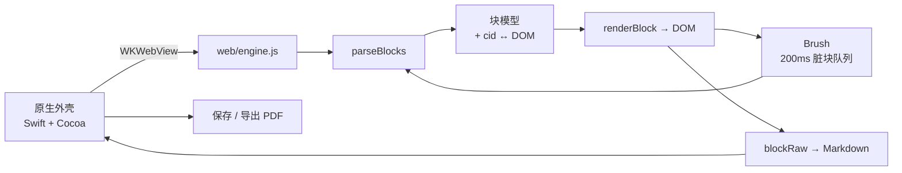

<div align="center">

# Markvis

**按 Typora 的架构实现的 macOS Markdown 编辑器 —— 原生 Cocoa 外壳 + WKWebView，不是 Electron。**

[](#构建从源码安装)
[](Sources/)
[](test/)
[](LICENSE)

[English](README.md) · 简体中文

</div>

---


### 这是什么

Markvis 是一个 macOS 上的所见即所得 Markdown 编辑器：在实时预览的正文里写 Markdown，导出排版好的 A4 PDF。

它起初是个实验：我先用 REA（Reverse Engineer Anything）逆向了 Typora 的架构，再照着同样的设计从零实现了一遍，看看这些设计是否真的立得住。结论是立得住，关键实现都写在代码和注释里。

它**不是** Typora 的替代品，也没打算做成替代品。它是一份能跑、能读的同构实现，运行时零第三方依赖。

**安装方式：从源码构建（见下文「构建」）。仓库不提供预编译或已公证的二进制。**

### 为什么它不是 Electron

Typora 在 macOS 上是「原生 Cocoa 外壳 + WKWebView」，Markvis 也是：

| | Electron 应用 | Markvis |
|---|---|---|
| 包体 | 约 150 MB | **约 3.9 MB**（其中约 2.5 MB 是 Mermaid） |
| 运行时 | Chromium + Node | 系统 WebKit |
| 原生桥 | IPC / preload | `WKScriptMessageHandler` + `prompt()` 同步通道 |

当前约 14,092 行：Swift 2,555 行、Web 内核 6,262 行、功能模块 2,549 行、测试 2,726 行。

### 功能

| 分类 | 能力 |
|---|---|
| **块级** | 段落、H1–H6、引用、有序/无序列表、围栏代码、表格、分隔线、YAML front matter、GFM 软/硬换行 |
| **行内** | 粗体、斜体、行内代码、删除线、行内链接与引用式链接、图片、括号/引号自动配对 |
| **实时预览** | 无损 DOM：行内元素的源码标记是**真实的隐藏文本节点**，Markdown 从 DOM 反推，不靠影子缓冲区 |
| **200ms 画笔** | 只重绘脏块；块内 HTML 相同就完全不碰 DOM |
| **`expand`** | 光标移进 `**粗体**`，标记浮出来 —— 而且可编辑：能删掉一个 `*`、能用方向键穿过去、能在中间插字 |
| **源码模式** | `Cmd+/` 在渲染视图和原文之间双向切换 |
| **代码块** | 围栏高亮（内置 36 种常用语言），实时模式右上角语言输入，输入字符筛选并选择，源码模式语言名补全 |
| **多文档** | 一份文档一个窗口，原生标签页组（`Cmd+T`）；重启恢复上次会话，重复打开同一文件只聚焦已有窗口 |
| **表格** | Tab / Shift-Tab 单元格导航、末格自动加行、Enter 单元格内换行（`<br>`）、CJK 内容友好的列宽 |
| **查找替换** | `Cmd+F`，用 CSS Custom Highlight —— 不往文档里插任何标记元素 |
| **大纲 / 文件侧栏** | `Cmd+Shift+O` 开关左侧统一侧栏，`Cmd+Shift+E` 直达文件 tab；大纲按标题层级折叠，宽度记忆 |
| **文件树** | 目录懒加载、当前文件高亮、外部改动自动刷新、新建/重命名/复制/删除、排序、树内拖拽、最近文件夹和上级目录；删除可撤销，移动重名自动改名 |
| **快速打开** | `Cmd+Shift+P` 模糊搜索当前文件夹内的文档，键盘选择并打开 |
| **输入补全** | 实时模式输入 `:smi` 补 emoji；源码模式围栏首行补代码语言名，支持 `py` / `js` / `ts` 等别名；↑↓/Enter/Tab/Esc 操作，插入可撤销 |
| **专注 / 打字机** | `Cmd+Shift+F` / `Cmd+Shift+T` |
| **主题** | 跟随系统 / 明亮 / 深色 / 护眼 / Nord，以及自己放进主题文件夹的 CSS；状态栏主题菜单切换，`Cmd+Shift+L` 循环 |
| **公式 / 图表** | `$x$` 与 `$$…$$`（KaTeX）、```` ```mermaid ```` 渲染成 SVG —— 都按需加载，点一下弹出源码浮层直接改 |
| **HTML 块** | 块级 HTML 在 sandbox iframe 里预览（脚本禁用），右上角 `</>` 打开源码浮层编辑；PDF / HTML 导出展开为普通 DOM |
| **脚注 / 目录** | `[^id]` 引用 + `[^id]: ...` 定义（点击互相跳转），`[TOC]` 按当前标题自动重建 |
| **拼写检查** | 输入时用系统词典检查（`Cmd+;` 切换） |
| **文件** | 双击 `.md`、拖拽打开、最近打开、命令行参数、自动保存、关窗确认、未命名文档崩溃恢复 |
| **导出** | 分页 A4 PDF、自包含 HTML（图片与 KaTeX 字体都内联为 data URL）、代码高亮、粘贴图片落到 `assets/` |

### 架构



文档模型是权威，但 DOM 是无损副本：

```
parseBlocks ──► 块树 ──► renderBlock
     ▲            │
     └── blockRaw ◄┘        getMarkdown() = 源码模式 ? textarea : blocks.map(blockRaw)
```

每个行内元素都带 `data-open` / `data-close`，存着自己的 Markdown 标记，所以 `blockRaw()` 能把 `<strong>粗体</strong>` 还原成 `**粗体**`，不需要第二份缓冲区。

### PDF 导出是怎么做的

这是最值得看的一部分（`web/engine.js` §13.5 与 `Sources/EditorWindow.swift`）。

WebKit 自带的打印在这里不可用 —— 这是实测结论，不是猜测：

| 方案 | 结果 |
|---|---|
| `WKWebView.printOperation(with:)` | 十万级空白页，150 MB+ |
| `NSPrintOperation(view:)` | 页数正常，但每页全白（WebKit 内容在独立进程里渲染） |

所以 Markvis 自己做分页：

1. **JS 排版**：把块装进 A4 页框（794 × 1123 px → 595 × 842 pt）。高过一页的块按行 / 按项拆段：表格按行、代码按行、列表按项、引用和 HTML 容器按子块；普通段落用 DOM Range 按可见字符切分，粗体、链接、行内代码、图片和 `<br>` 跨页保留。
2. **逐页捕获**：原生在独立离屏 `WKWebView` 里一页一页 `createPDF`，每次只截一个精确的页面矩形。
3. **合并**：PDFKit 把每页缩放进 A4，写出最终文件。

排版参数对齐 Typora 的导出结果：正文 9.1pt、左右边距 13mm、标题无下划线、表格续页不重复表头、不渲染 front matter。

四个静默踩过的坑，现在都有测试兜着：

- WKWebView 里 `file://` 样式表的 `cssRules` 会抛 `SecurityError` → 导出 HTML 几乎没有样式。改为从 app bundle 注入 `style.css`。
- 代码块在导出页折行、测量时却不折行 → 页尾两行被裁掉。
- `PDFPage` 对 `PDFDocument` 是弱引用 → 合并时偶尔出现空页。现在改为保存 `PDFDocument` 本身，页面不再比它的宿主活得久。
- 最初的「整页快照 + 坐标切片」方案在页边界必然重叠，已整体删除。

### 自定义主题

主题就是一份普通的 CSS。把文件丢进 `~/Library/Application Support/Markvis/themes/`，它就会出现在右下角的主题菜单里（首次启动会自动建好目录并放一份带注释的 `example.css`；菜单 →「打开主题文件夹…」也能直接跳过去）。

```css
/* @name: 纸墨 */
/* @base: light */

:root {
  --bg: #fbf8f3;
  --fg: #2f2a23;
  --accent: #8a5a2b;
  --mf-editor-width: 900px;
}
```

- `@name` 是菜单里显示的名字，不写就用文件名
- `@base` 指定打底的主题：`auto` / `light` / `dark` / `sepia` / `nord`。做暗色主题一定要写 `dark`，否则没被覆盖到的部分还是亮色
- 所有颜色都是 CSS 变量：`--bg`、`--fg`、`--muted`、`--accent`、`--mark`、`--code-bg`、`--border`、`--quote`，代码高亮是 `--hl-*`，正文栏宽是 `--mf-editor-width`
- 只认单行指令（`/* @name: x */` 或裸写 `@name: x`），所以多行注释里的说明文字不会被误当成元信息
- 上次加载的 CSS 会缓存在 `localStorage`，启动时先顶上再读盘；改完文件在菜单里点「重新加载」即可生效

> 主题是纯 CSS，不能执行脚本；导出 PDF 固定用浅色版式，暗色主题不会把 PDF 变成黑底。

### 构建（从源码安装）

**仓库只提供源码，不提供已公证的二进制。** Apple 公证需要付费的 Developer ID 账号，个人证书还会把法定姓名和 Team ID 公开写进签名；因此官方分发的唯一方式是自行构建。

要求：macOS 13+、Swift 6 工具链（`xcode-select --install`）。构建本身不需要 npm、不需要 Xcode 工程、运行时没有第三方依赖；只有跑 JS 测试才用得到 `playwright-core`。

```bash
git clone https://github.com/Linley116/Markvis.git markvis
cd markvis
./build.sh          # 编译 + 安装到 ~/Applications
```

`build.sh` 用 `swiftc` 编译六个 Swift 文件，先在非 `.app` 的 `build/stage` 里组装，再 rsync 覆盖安装到 `~/Applications`；构建中转不会被 LaunchServices 注册，启动台只保留一份。源码是你自己拉的、产物是你自己编的，本地运行不需要 Apple 公证。

只构建、不安装：

```bash
./build.sh --keep                    # 保留 build/Markvis.bundle（供 release.sh 打包）
MARKVIS_NO_INSTALL=1 ./build.sh --keep   # 只构建，不动 ~/Applications
```

DMG 打包脚本 `release.sh` 仅保留给维护者在自己的机器上使用；它产出 ad-hoc 签名、未公证的 DMG，**不要作为公开下载**，别人打开时会被 Gatekeeper 拦截。

> `web/vendor/highlight.min.js`（highlight.js 11.9.0，BSD-3-Clause）是刻意内置的，保证没网也能构建。

### 快捷键

| 操作 | 快捷键 |
|---|---|
| 新建 / 新标签页 / 打开 / 保存 | `Cmd+N` / `Cmd+T` / `Cmd+O` / `Cmd+S` |
| 拼写检查开关 | `Cmd+;` |
| 硬换行 | `Shift+Enter`（或行尾两个空格 / `\`，GFM 语法） |
| 表格单元格内换行 | `Enter` / `Shift+Enter`（写成 `<br>`，不破坏表格） |
| 导出 PDF / HTML | File → Export |
| 粗体 / 斜体 / 行内代码 | `Cmd+B` / `Cmd+I` / `Cmd+K` |
| 切换源码模式 | `Cmd+/` |
| 查找替换 | `Cmd+F` |
| 显示 / 隐藏侧栏 | `Shift+Cmd+O` |
| 显示文件树 | `Shift+Cmd+E` |
| 快速打开 | `Shift+Cmd+P` |
| 专注模式 / 打字机 | `Shift+Cmd+F` / `Shift+Cmd+T` |
| 下一个主题 | `Shift+Cmd+L` |
| 放大 / 缩小 / 实际大小 | `Cmd++` / `Cmd+-` / `Cmd+0` |

### 测试

```bash
node test/engine.test.js      # 138 项 —— 核心闭环
node test/features.test.js    # 131 项 —— 功能
./test/native.sh                                       # 原生 Swift 测试
node test/bench.js                                     # 性能基准
./test/pdf-regression.sh                               # PDF 结构 + 内容
```

JS 套件用无头 Chrome 驱动真实 DOM（`playwright-core` 是唯一的开发依赖，`npm ci` 后执行 `playwright-core install chromium` 即可；也可用 `MARKVIS_TEST_CHROME` 指定浏览器）。原生套件覆盖路径安全、会话恢复、文件操作与撤销、文件树排序和快速打开索引；完整 Xcode 下走 XCTest，只有 Command Line Tools 时自动使用同一组场景的轻量运行器。PDF 回归会导出一份包含 60 行表格、80 行代码块和结尾标记的文档，然后检查：多页、无空白页、A4 尺寸一致、填充率、结尾标记是否还在。

### 已知限制

- 嵌套块已经支持（列表嵌列表、条目里放代码块/引用、引用里多段）。表格仍不能嵌套；块级 HTML 在 sandbox iframe 里渲染，脚本被禁用，编辑走右上角 `</>` 源码浮层。
- 表格单元格换行写成 `<br>`；Markdown 表格本身不支持单元格内段落。
- 撤销是快照式的（每步存整篇 + 光标），所以能跨模式、跨重解析；代价是一步会还原整篇文档，超大文件上不如增量方案省。
- 图片只支持「已保存文档里的粘贴」（落到同级 `assets/`）；相对路径在编辑器里能正常解析，导出时会内联为 data URL。
- 块级 HTML 里的脚本不执行；PDF 会按顶层块元素拆分 HTML，但单个不可拆元素超过一页时仍可能被页底裁掉。
- 主题是纯 CSS，不能执行脚本；导出 PDF 固定用浅色版式，暗色主题不会把 PDF 变成黑底。
- 官方只提供源码，不提供预编译或已公证的二进制；`release.sh` 打出的 DMG 仅供维护者本机或内部使用。

### 路线图

见 [ROADMAP.md](ROADMAP.md) —— 迭代排期是一张带勾选列的表，后面跟着按版本整理的修复记录、暂缓项和踩坑记录。对外分发采用源码构建，不做 Apple 公证；增量落盘经评估后暂缓、不再排期。

### 许可证

MIT，见 [LICENSE](LICENSE)（含第三方声明）。
